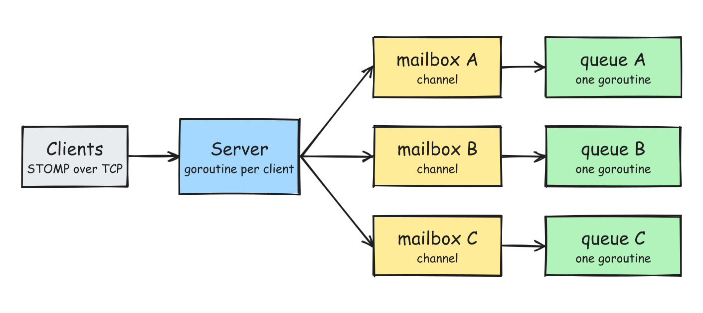

# minimq

A small message broker in Go, modeled on RabbitMQ. I am building it from scratch to learn how brokers work inside.

## What is built so far



The diagram shows the target with several queues. The code has one `Queue` type so far.

`Server` is a multithreaded server. It handles each client in its own goroutine.

## Run it

Start the server:

```bash
go run .
```

In another terminal, send a message:

```bash
go run ./testing -dest /queue/orders -body "order 42"
```

## How RabbitMQ does it and how minimq does it

| Topic | RabbitMQ | minimq |
|---|---|---|
| Language and runtime | Erlang on the BEAM virtual machine | Go |
| Unit of concurrency | Erlang process | Goroutine |
| Wire protocol | AMQP 0-9-1 (STOMP and MQTT through plugins) | STOMP |
| Client connection | One process per connection, plus one per channel | One goroutine per connection |
| Queue | One process per queue | One goroutine per queue (`Queue.Run`) |
| Queue mailbox | Process mailbox with no size limit | Unbuffered Go channel |
| Backpressure | Credit flow: a sender stops when it runs out of credits | A send waits until `Run` receives it |
| Shared state | None. Processes only send messages to each other. | None in the queue. Only `Run` touches the queue's data. |
| Finding a queue by name | Database (Mnesia, now Khepri) plus fast ETS tables | Not built. One queue for now. |
| Delivery to consumers | Queue pushes messages to subscribed consumers | Not built |

## Trade-offs of the current design

Advantages:

- **No locks.** Only the `Run` goroutine touches the queue, so the queue has no data races.
- **Small code.** The broker is four short files: `main.go`, `server.go`, `stomp.go`, and `queue.go`.
- **Easy to test by hand.** STOMP is plain text, so `nc` and existing STOMP clients work.
- **Queues can run in parallel later.** Each queue gets its own goroutine, so a second queue does not wait on the first.

Disadvantages:

- **Serial queue.** One slow step in `Run` delays every message behind it.
- **Unbuffered mailbox.** Every sender waits until `Run` takes its message.
- **One core per queue.** A single busy queue cannot use more than one CPU core.
- **Memory only.** The server loses all messages when it stops.
- **No replies.** The server sends nothing back, so real STOMP clients wait forever for `CONNECTED`.
- **Bad input closes the connection.** One malformed frame ends the client's session.
